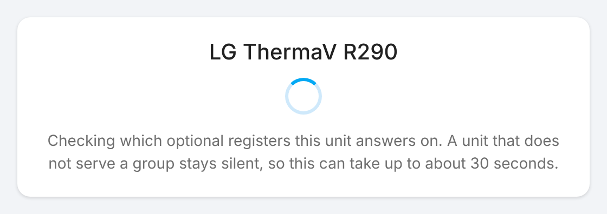
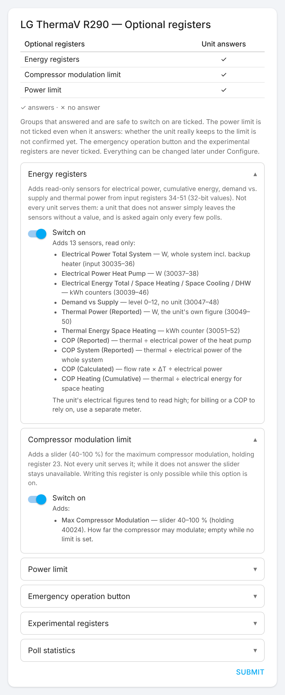
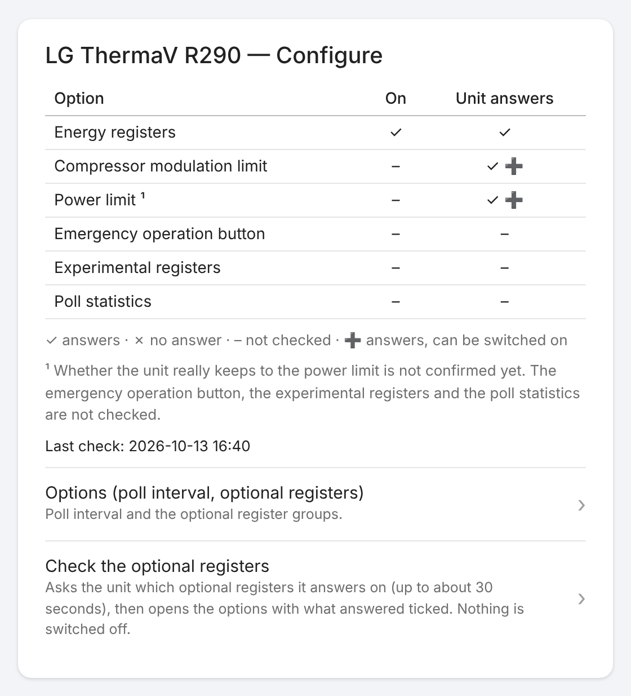
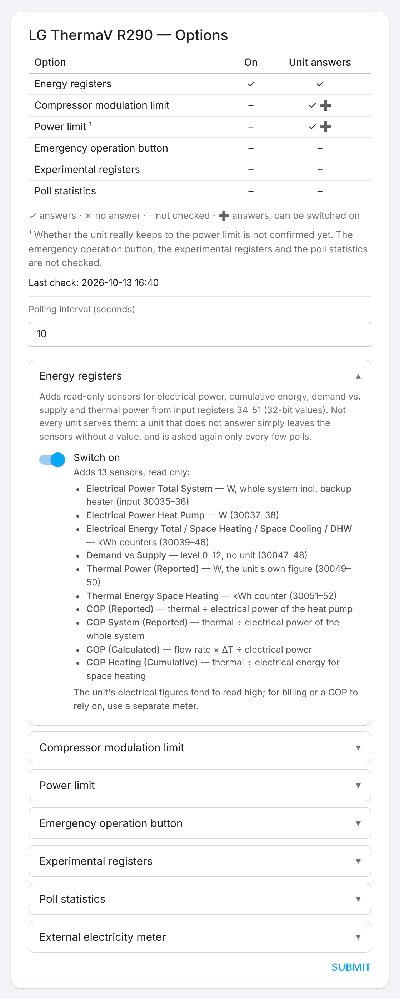

# LG ThermaV R290 — Home Assistant Integration

HACS custom integration for the LG ThermaV R290 heat pump via Modbus TCP or RTU.

Based on [cjungde/ha-lg-thermav-modbus](https://github.com/cjungde/ha-lg-thermav-modbus) by [@cjungde](https://github.com/cjungde), who had the original idea and wrote the first version. This repository continues it.

Replaces a hand-crafted YAML Modbus configuration with native HA entities: sensors, binary sensors, switches, buttons, number inputs, and select dropdowns — all updated on every poll cycle without requiring template sensors or automations.

## Contents

- [Features](#features)
- [Coming from a YAML setup?](#coming-from-a-yaml-setup)
- [Experimental registers](#experimental-registers)
- [Requirements](#requirements)
- [Installation via HACS](#installation-via-hacs)
  - [Manual installation](#manual-installation)
- [Configuration](#configuration)
  - [Which options the unit supports](#which-options-the-unit-supports)
- [Entities](#entities)
  - [Sensors](#sensors)
    - [COP with your own meter (option)](#cop-with-your-own-meter-option)
    - [Compressor statistics (option)](#compressor-statistics-option)
    - [Poll statistics (option)](#poll-statistics-option)
  - [Energy registers (optional)](#energy-registers-optional)
  - [Binary sensors](#binary-sensors)
  - [Switches](#switches)
  - [Buttons](#buttons)
  - [Number inputs](#number-inputs)
    - [Max compressor modulation (optional)](#max-compressor-modulation-optional)
    - [Power limit (optional)](#power-limit-optional)
  - [Select inputs](#select-inputs)
- [Modbus register map](#modbus-register-map)
- [Notes](#notes)
- [Reporting a problem](#reporting-a-problem)
- [License](#license)

---

## Features

- **Sensors** — temperatures (inlet, outlet, DHW, outdoor, refrigerant circuit), flow rate, pressures, compressor speed, error code, operation mode, control method, energy state
- **Energy registers (optional)** — electrical power, cumulative electrical energy per mode, demand vs. supply and the unit's own thermal power from input registers 34–51; off by default, see [Energy registers](#energy-registers-optional)
- **Computed thermal power sensors** — total / heating circuit / DHW, calculated from flow rate and ΔT each poll cycle (Q = flow/60 × ΔT × 4186 W)
- **Binary sensors** — compressor, pumps, DHW heating, defrost, backup heater stages, fault, silent mode, cooling, emergency modes, energy state slots 0–8
- **Switches** — heating/cooling, DHW, silent mode, emergency stop; optional power limit
- **Buttons** — start DHW disinfection (momentary trigger coil); optional start emergency operation
- **Number inputs** — flow temperature setpoints (circuit 1, circuit 2), DHW target temperature, heating curve shift values (circuit 1, circuit 2); optional max compressor modulation (40–100 %) and max electrical power (0.1–25.0 kW)
- **Select inputs** — operation mode (Heating / Cooling / Auto), control method (outlet temp / inlet temp / room air)
- Supports **Modbus TCP**, **Modbus TCP-RTU**, and **Modbus RTU** (serial)
- Configurable poll interval (default 10 s), reconfigurable without restart
- Shares one Modbus connection with every other integration on the same gateway

---

## Coming from a YAML setup?

- **basti242's setup:** [entity translation table](docs/migration-from-yaml.md): every entity of [basti242/homeassistant_lg_therma_v_modbus](https://github.com/basti242/homeassistant_lg_therma_v_modbus) next to its counterpart here, including the differences that matter when switching (inverted water-flow bit, missing write entities).
- **isarrider's setup (12 kW, RTU):** [migration guide](docs/migration-from-isarrider-yaml.md): every entity, helper, template sensor and automation of [isarrider/homeassistant_lg_therma_v_modbus](https://github.com/isarrider/homeassistant_lg_therma_v_modbus) mapped to the integration, which options to switch on, every difference in behaviour, how to keep history, and how to rewrite automations.

---

## Experimental registers

The device answers on 18 registers that the manual does not list (a read-only scan on 2026-10-03, R290 9 kW):

| Type | Registers |
|---|---|
| Input | 30015, 30018, 30064 |
| Holding | 40011–40023, 40063, 40064 |

Nothing in the manual or in the community projects I could find explains them. To find out what they are, the integration can record them over a longer time.

Switch it on under *Settings → Devices & Services → LG ThermaV R290 → Configure → Experimental registers*. This adds 18 diagnostic sensors named `Experimental Input 30015`, `Experimental Holding 40011`, … They carry the raw, unscaled 16-bit value and have long-term statistics, so they can be compared with compressor speed, temperatures and defrost cycles. Switching the option off removes them again.

**They are read-only.** The integration only ever writes a fixed list of known addresses (holding 0, 1, 2, 4, 5, 7, 8 and coils 0–4, plus holding 23 while the compressor modulation limit option is on, holding 24 and coil 6 while the power limit option is on, and coil 5 while the emergency operation button option is on); every other write is refused before it reaches the bus, so none of these registers can be written by the integration, whichever entity or service asks. They are read in four blocks. A block the unit does not answer is not asked again until Home Assistant restarts or the integration is reloaded, and its sensors show *unavailable*: at once if the unit refuses the addresses, after three timeouts in a row if it stays silent. The other blocks and all other values are not affected.

The full result of the scan, what the manual lists and what it does not, is in [docs/register-scan.md](docs/register-scan.md).

Please tell me what you see, in particular if the values move with the compressor. A first reading from my unit: input 30015 reads 64887 (−64.9 °C as a signed tenth, the pattern of a temperature channel without a sensor), input 30018 reads 12000, and all of holding 40011–40023 read 0.

---

## Requirements

**Home Assistant 2026.10.1 or newer**, the version the tests run against.
From version 1.0.0 the integration no longer speaks to the bus itself. It asks Home Assistant's `modbus` component
for a unit on a *shared* connection, which means:

- Every integration pointing at the same gateway with the same link settings
  ends up on one connection, and their requests serialize behind its lock.
  This matters on RS485, where the line can only carry one conversation at a
  time: two clients with two sockets onto one gateway interleave their
  requests and provoke transaction-id mismatches and framing errors that hit
  *both* of them.
- The Modbus stack is Home Assistant's own (`modbus-connection` on the tmodbus
  backend), so nothing is installed into the container on our behalf. The
  `requirements` list in the manifest is empty.
- The same device may not be claimed twice with different link settings —
  plain TCP and RTU-over-TCP on one socket, say. The config flow reports that
  as an error rather than silently reframing.

---

## Installation via HACS

1. In HACS → Integrations → ⋮ → Custom repositories, add `https://github.com/isarrider/ha-lg-therma-v-modbus` with category **Integration**.
2. Install "LG ThermaV R290".
3. Restart Home Assistant.
4. Settings → Devices & Services → Add Integration → search "LG ThermaV R290".

### Manual installation

Copy the `custom_components/lg_thermav_r290/` folder into your HA `custom_components/` directory and restart.

---

## Configuration

The config flow asks for connection type first, then connection-specific parameters:

| Parameter | Default | Notes |
|---|---|---|
| Connection type | — | TCP / TCP-RTU / RTU |
| Host / IP | — | TCP only |
| Port | 502 | TCP only |
| Serial port | — | RTU only (e.g. `/dev/ttyUSB0`) |
| Baudrate | 9600 | RTU only |
| Parity | N | RTU only |
| Stop bits | 1 | RTU only |
| Slave ID | 1 | 1–247 |
| Poll interval | 10 s | Adjustable in Options (5–3600 s). Entries set up before the default changed keep their stored value. |
| Energy registers | off | Options; input 34–51, not served by every unit |
| Compressor modulation limit | off | Options; holding 23, not served by every unit |
| Power limit | off | Options; coil 6 + holding 24, not served by every unit; effect not confirmed yet |
| Emergency operation button | off | Options; coil 5 |
| Experimental registers | off | Options; 18 undocumented registers, read only |
| Compressor statistics | off | Options; *Compressor Starts*, *Run Time*, *Average Speed* |
| Poll statistics | off | Options; *Poll Duration* and *Bus Load* diagnostic sensors |

### Which options the unit supports

After the connection test, the setup asks the unit once which optional register groups it answers on, and shows the result (✓ answers, ✗ no answer) as a table on a last step with the options:

| Option | Checked | Ticked when the unit answers |
|---|---|---|
| Energy registers | input 34–51 | yes (read only) |
| Compressor modulation limit | holding 23 | yes (adds the slider; nothing is written until it is moved) |
| Power limit | coil 6, then holding 24 | no: whether the unit keeps to the limit is not confirmed yet |
| Emergency operation button | — | never: coil 5 answers on every unit; the option is off because of what it does |
| Experimental registers | — | never |
| Compressor statistics | — | never: nothing to check on the unit |
| Poll statistics | — | never: nothing to check on the unit |

Answering only proves the register exists, not that writing it has an effect. A unit that does not serve a group stays silent, so each missing group waits for a request timeout: on a unit that has none of them, the check takes up to about 30 seconds, shown as progress. It runs only then, never while polling.

 

*Illustrations of a 12 kW unit that answers on all three groups; Home Assistant's own dialogs look slightly different.*

**Configure** opens a menu. At the top, a table shows per optional group whether it is on and what the unit answered on the last check; ➕ marks a group the unit answers on but that is off, i.e. what could be switched on. Below it:

- **Options**: the poll interval and the optional groups, with the same table above them. Each option is a section you can expand: it says what the option is for and lists every entity it adds (name, unit, register). Sections of options that are on open expanded; the others stay collapsed.
- **Check the optional registers**: asks the unit again (up to about 30 seconds), then opens the options with the groups that answered ticked, as at setup. Nothing is switched off. Useful on an installation set up before 1.5.0 (the table shows – until then) or after a firmware update.

 

---

## Entities

A ready-to-paste dashboard with temperatures, compressor, COP, controls and per-day statistics, built from Home Assistant's own cards: [docs/dashboard.md](docs/dashboard.md).

### Sensors

| Entity | Description | Unit |
|---|---|---|
| `sensor.lg_thermav_r290_inlet_temperature` | Inlet water temperature | °C |
| `sensor.lg_thermav_r290_outlet_temperature` | Outlet water temperature | °C |
| `sensor.lg_thermav_r290_dhw_temperature` | DHW tank temperature | °C |
| `sensor.lg_thermav_r290_outdoor_temperature` | Outdoor air temperature | °C |
| `sensor.lg_thermav_r290_backup_heater_outlet_temperature` | Backup heater outlet temp | °C |
| `sensor.lg_thermav_r290_flow_temperature_circuit_2` | Flow temperature circuit 2 | °C |
| `sensor.lg_thermav_r290_room_air_temperature_circuit_1` | Room air temperature circuit 1, measured at the wired remote controller. **Without a wired remote, the indoor unit's own sensor**: the temperature of the room the unit is installed in, see [*Notes*](#notes) | °C |
| `sensor.lg_thermav_r290_room_air_temperature_circuit_2` | Room air temperature circuit 2 | °C |
| `sensor.lg_thermav_r290_flow_rate` | Water flow rate (device class `volume_flow_rate`) | L/min |
| `sensor.lg_thermav_r290_water_pressure` | Water pressure | bar |
| `sensor.lg_thermav_r290_high_pressure_condenser` | High pressure (condenser) | bar |
| `sensor.lg_thermav_r290_low_pressure_evaporator` | Low pressure (evaporator) | bar |
| `sensor.lg_thermav_r290_compressor_speed` | Compressor speed | rpm |
| `sensor.lg_thermav_r290_error_code` | Error code | — |
| `sensor.lg_thermav_r290_operation_state_odu` | Outdoor unit cycle as text: Standby/Off, Cooling, Heating (input 30002; raw value in *Operation Cycle (ODU)*) | — |
| `sensor.lg_thermav_r290_thermal_power_calculated` | Thermal power, calculated from flow rate × ΔT | W |
| `sensor.lg_thermav_r290_thermal_power_heating_circuit_calculated` | Same, while not heating DHW (0 otherwise) | W |
| `sensor.lg_thermav_r290_thermal_power_dhw_calculated` | Same, while heating DHW (0 otherwise) | W |
| `sensor.lg_thermav_r290_operation_mode` | Operation mode (label) | — |
| `sensor.lg_thermav_r290_control_method` | Control method (label) | — |
| `sensor.lg_thermav_r290_energy_state` | Energy state (label), holding 9: the command register | — |
| `sensor.lg_thermav_r290_energy_state_reported` | Energy state (label), input 11: the state the unit reports as active | — |

#### COP with your own meter (option)

The electrical figures the unit reports tend to read high, so COPs built on them come out too low. Under *Configure → Options → External electricity meter*, pick sensors of your own meter for the heat pump (e.g. from vzlogger or a smart plug); both fields are optional:

| You pick | Entity | What it shows |
|---|---|---|
| a power sensor (W or kW) | `sensor.lg_thermav_r290_cop_external_meter` | thermal power from flow rate × ΔT ÷ your meter's power: the COP of the moment; no value below 100 W |
| an energy sensor (a total counter, Wh or kWh) | `sensor.lg_thermav_r290_thermal_energy_calculated` | flow rate × ΔT added up over time, kWh, `total_increasing` |
| | `sensor.lg_thermav_r290_cop_cumulative_external_meter` | that thermal energy ÷ your meter's energy, both counted from when the sensor was set: the seasonal performance factor (JAZ) over that period; attributes `since`, `thermal_energy_kwh`, `electrical_energy_kwh` |

Both counters are kept across restarts. Gaps over five minutes (Home Assistant down, the unit not answering) are not counted rather than guessed; a reset of your meter's counter counts as growth from zero. Choosing another energy sensor starts a new period. The thermal side is flow rate × ΔT, which reads 0 while cooling or defrosting.

#### Compressor statistics (option)

Switch on **Compressor statistics** in *Configure → Options*. Counted from the *Compressor* status and *Compressor Speed* on every poll; nothing extra is read from the unit.

| Entity | What it shows |
|---|---|
| `sensor.lg_thermav_r290_compressor_starts` | starts, a `total_increasing` counter: starts per day or per hour come from Home Assistant's statistics (e.g. a *Statistic* card, *change* per day). Attribute `last_run_minutes`: the run in progress, or the last one |
| `sensor.lg_thermav_r290_compressor_run_time` | hours the compressor ran, a counter |
| `sensor.lg_thermav_r290_compressor_average_speed` | rpm while running, today; resets at midnight, so the history shows one value per day. Standstill is left out. Attributes `day`, `run_hours_today` |

Many short runs mean the unit is cycling, which costs efficiency and wear; a low average speed over long runs means it mostly modulates at the bottom of its range. All three are kept across restarts; a gap over five minutes is not counted, and a restart never counts as a start.

#### Poll statistics (option)

| Entity | Description | Unit |
|---|---|---|
| `sensor.lg_thermav_r290_poll_duration` | How long the last poll took, from its first request to its last, including any wait for the bus; attribute `requests`: the reads in that poll | ms |
| `sensor.lg_thermav_r290_bus_load` | Poll duration ÷ poll interval: how much of the time this integration keeps the bus busy | % |

Switch on **Poll statistics** in *Configure → Options* to get both; switched off, they are removed again. They are under *Diagnostic* on the device page, with long-term statistics, to see how much your bus carries, e.g. before shortening the poll interval or switching on more options. Nothing extra is read from the unit: the integration times the poll it makes anyway. On a bus of its own (a USB adapter) *Bus Load* is the whole bus; on a gateway shared with other devices, it is this integration's share plus its waiting.

Both energy state sensors show the value in front of its name, `0 – Not Used` … `8 – Super Energy Saving Mode`; a value outside 0–8 shows as the bare number. (Up to 1.2.0, *Energy State* showed the name alone, e.g. `Normal Operation`; automations comparing its state need the new text.)

### Energy registers (optional)

Switch on **Energy registers** in the integration's options. These are 32-bit values in input registers 34–51 that the manual does not list. Not every unit serves them: a read-only scan of a 9 kW unit got no answer from input 25–62, while a 12 kW unit answers on 34–51.

> **Do not rely on the electrical values.** The electrical power and energy the heat pump reports (input 34–45) deviate noticeably from a calibrated meter: compared against a smart meter on the 12 kW unit, the unit usually reported **too high** a power. The energy counters are presumably derived from that power and are then likely too high as well; that part has not been measured separately. Treat all of them as the unit's own estimate. Everything built on them inherits the error, and since the electrical side is in the denominator, the COPs tend to come out **too low**: *COP (Reported)*, *COP System (Reported)*, *COP (Calculated)* and *COP Heating (Cumulative)*. For billing, the Energy dashboard or a COP you want to rely on, measure the heat pump's electrical consumption with a separate meter (a smart meter, or a dedicated meter in the heat pump's supply) and use that instead.

| Entity | Registers | Unit |
| --- | --- | --- |
| `sensor.lg_thermav_r290_electrical_power_total_system` | 34–35 | W |
| `sensor.lg_thermav_r290_electrical_power_heat_pump` | 36–37 | W |
| `sensor.lg_thermav_r290_electrical_energy_total` | 38–39 | Wh (shown as kWh) |
| `sensor.lg_thermav_r290_electrical_energy_space_heating` | 40–41 | Wh (shown as kWh) |
| `sensor.lg_thermav_r290_electrical_energy_space_cooling` | 42–43 | Wh (shown as kWh) |
| `sensor.lg_thermav_r290_electrical_energy_dhw` | 44–45 | Wh (shown as kWh) |
| `sensor.lg_thermav_r290_demand_vs_supply` | 46–47 | none (reads 0–12 on a 12 kW unit) |
| `sensor.lg_thermav_r290_thermal_power_reported` | 48–49 | W |
| `sensor.lg_thermav_r290_thermal_energy_space_heating` | 50–51 | Wh (shown as kWh) |

The block is read in one request, high word first. A unit that does not answer leaves the sensors without a value and does not affect the other entities; after three misses in a row the read is skipped for 20 polls before it is tried again, so a unit that does not serve the block costs a few timeouts, not one per poll. Registers 52–55 (cumulative thermal yield for cooling and DHW) are not read; they do not answer on a 12 kW unit. Switching the option off removes the sensors again.

The option also adds `sensor.lg_thermav_r290_cop_heating_cumulative`: thermal energy for space heating (input 50) divided by electrical energy for space heating (input 40). Both are counters since the unit's counters were last reset, so this is a long-term average (closer to a seasonal performance factor), not the COP of the moment. It has no value until electrical energy has been counted.

`thermal_power_reported` is the unit's own figure and is separate from the computed `thermal_power_*` sensors below.

The option also adds `sensor.lg_thermav_r290_cop_reported`: the unit's thermal power (input 48) divided by the heat pump's electrical power (input 36), the COP of the moment, in space heating and DHW alike. It has no value while the electrical power is below 100 W, i.e. while the unit idles, so standby periods do not drag down its statistics.

`sensor.lg_thermav_r290_cop_system_reported` is the same, but over the total system's electrical power (input 34) instead of the heat pump's (input 36). Where the two are equal, so are the COPs; when something the heat pump figure leaves out draws power, such as a backup heater, the system COP is the lower, more honest one.

`sensor.lg_thermav_r290_cop_calculated` is a cross-check of `cop_reported`: same electrical side (input 36), but the thermal side is the integration's own figure from flow rate × ΔT (the same calculation as `thermal_power_calculated`) instead of the unit's thermal power register (input 48). If the two COPs agree, the unit's thermal figure can be trusted; if they differ consistently, one of the two thermal values is off. Same idle rule (no value below 100 W).

### Binary sensors

| Entity | Description |
|---|---|
| `binary_sensor.lg_thermav_r290_compressor` | Compressor running |
| `binary_sensor.lg_thermav_r290_water_pump` | Water pump running |
| `binary_sensor.lg_thermav_r290_external_water_pump` | External water pump |
| `binary_sensor.lg_thermav_r290_dhw_heating` | DHW heating active |
| `binary_sensor.lg_thermav_r290_defrost` | Defrost active |
| `binary_sensor.lg_thermav_r290_dhw_disinfection` | DHW disinfection |
| `binary_sensor.lg_thermav_r290_backup_heater_step_1` | Backup heater step 1 |
| `binary_sensor.lg_thermav_r290_backup_heater_step_2` | Backup heater step 2 |
| `binary_sensor.lg_thermav_r290_dhw_boost_heater` | DHW boost heater |
| `binary_sensor.lg_thermav_r290_fault` | Fault active |
| `binary_sensor.lg_thermav_r290_silent_mode` | Silent mode |
| `binary_sensor.lg_thermav_r290_cooling_active` | Cooling active |
| `binary_sensor.lg_thermav_r290_water_flow` | Water flow present (see note below) |
| `binary_sensor.lg_thermav_r290_energy_state_normal_operation` | Energy state: normal (value 2) |
| … | Energy states 0–8 as individual binary sensors |

> **Note on discrete input 10001 (water flow).** The LG manual documents this bit as
> `0 = flow rate OK / 1 = flow rate too low`. On the R290 monoblock it behaves the
> other way round: the bit is set while water is flowing. Measured on 2026-08-18 —
> `di[0] = 0` at 5.0 LPM with the pump off, `di[0] = 1` at 15.3 and 29.5 LPM with the
> pump running, with `di[0]` and `di[1]` (pump) identical in every sample of the same
> poll. A read offset is ruled out, since `di[3]` (compressor) and `di[5]` (DHW heating)
> stay correctly aligned.
>
> The entity is therefore exposed as `binary_sensor.lg_thermav_r290_water_flow` with
> device class `running`. Exposing it as a `problem` sensor (as the manual suggests)
> would raise a false problem alert on every pump run.

> **Note on discrete input 10009 (cooling status).** The R290 manual (p. 158,
> *Diskretes Register 0x02*) documents this bit as `0 = no cooling / 1 = cooling
> operation`. On this unit the bit is set **while the heat pump is heating**.
> Measured on 2026-09-24: `di[8] = 1` with the compressor running, flow 37.8 °C
> above return 35.7 °C and 3487 W going into the heating circuit, operation mode
> `Auto`, no cooling anywhere in the system.
>
> A read offset is ruled out. `di[1]`/`di[2]` tracked a 3-minute-on / 15-minute-off
> pump cycle correctly to the second, `di[3]` (compressor) is consistent over days,
> and `di[13]`–`di[16]` match the R290 manual exactly (10014 fault, 10015 emergency
> space heating, 10016 emergency DHW, 10017 mix pump). Note that the memory map of
> other Therma V models differs here — on the HN1600MC, 10014 is *Emergency
> Operation Available (DHW)*. **Use the R290 manual, not a generic Therma V one.**
>
> The bit does not correlate with compressor state either: it stayed `on`
> continuously from 2026-09-21 22:03 to 2026-09-24 07:02 while the unit started and
> stopped repeatedly. What it actually reports on this model is unknown.
>
> The entity `binary_sensor.lg_thermav_r290_cooling_active` is therefore **not
> usable for diagnostics** on the R290 monoblock. It is left in place because the
> register is read anyway and the mapping follows the manual — but do not build
> automations on it.
>
> This is the **second** discrete input on this model that departs from the
> manufacturer's description, after 10001 above.

### Switches

| Entity | Modbus coil |
|---|---|
| `switch.lg_thermav_r290_heating_cooling` | Coil 0 (00001: enable/disable heating/cooling; DHW is coil 1) |
| `switch.lg_thermav_r290_dhw` | Coil 1 |
| `switch.lg_thermav_r290_silent_mode` | Coil 2 |
| `switch.lg_thermav_r290_emergency_stop` | Coil 4 |
| `switch.lg_thermav_r290_power_limit` | Coil 6 (00007) — **option, off by default**, see [Power limit](#power-limit-optional) |

### Buttons

Coils 3 and 5 are momentary triggers, not state switches. The manual specifies
both as `0: hold status / 1: start operation` — the unit clears the coil by
itself after the write, so reading it back is never a confirmation. Use the
binary sensors to see the status.

| Entity | Modbus coil | Status entity |
|---|---|---|
| `button.lg_thermav_r290_start_disinfection` | Coil 3 (00004, trigger) | `binary_sensor.lg_thermav_r290_dhw_disinfection` (discrete 6) |
| `button.lg_thermav_r290_start_emergency_operation` | Coil 5 (00006, trigger) — **option, off by default** | `binary_sensor.lg_thermav_r290_emergency_heating_cooling_available` / `…_emergency_dhw_available` (discrete 14 / 15) |

> A trigger coil modelled as a switch would always read back `off`, even when the
> write succeeded, which is why this is a button. Note that the trigger
> only has an effect if disinfection is enabled on the unit itself
> (installer menu → DHW → disinfection active; factory default is off).

> **Start Emergency Operation** only exists while the option *Emergency operation
> button* is on (*Configure*), and coil 5 can only be written then. The manual calls
> coil 00006 *Auslöser Notaus-Betrieb*. Emergency operation typically heats with the
> backup heater and draws far more power than the heat pump itself, so the button
> is not created by default. Not to be confused with coil 4 (00005, *Notaus*),
> which is the `switch.lg_thermav_r290_emergency_stop` (0 normal / 1 emergency stop).

### Number inputs

| Entity | Range | Holding register |
|---|---|---|
| `number.lg_thermav_r290_target_temperature_circuit_1_radiators` | 20–60 °C | 2 (×0.1) |
| `number.lg_thermav_r290_target_temperature_circuit_2_underfloor` | 20–40 °C | 5 (×0.1) |
| `number.lg_thermav_r290_dhw_target_temperature` | 35–65 °C | 8 (×0.1) |
| `number.lg_thermav_r290_setpoint_shift_circuit_1` | −5…+5 K | 4 (signed) |
| `number.lg_thermav_r290_setpoint_shift_circuit_2` | −5…+5 K | 7 (signed) |
| `number.lg_thermav_r290_max_compressor_modulation` | 40–100 % | 23 (optional, see below) |
| `number.lg_thermav_r290_max_electrical_power` | 0.1–25.0 kW | 24 (×0.1, optional, see below) |

#### Max compressor modulation (optional)

Switch on **Compressor modulation limit** in the integration's options. Holding register 23 (40024) caps how far the compressor may modulate, in percent: 40–100 sets a limit, 0 means no limit is set. It is not in the manual's table and not every unit serves it — the 9 kW unit in [docs/register-scan.md](docs/register-scan.md) does not answer on it, a 12 kW unit does.

- Writable **only while the option is on**; with it off the integration refuses every write to register 23.
- Every write is clamped to 40–100 % and read back, so the slider shows what the unit stored.
- While the unit reports 0 (no limit), the slider shows *unknown*; the attributes `register_value` and `limit_active` show the raw state.
- A unit that does not answer leaves the slider unavailable, with the same back-off as the energy registers. Switching the option off removes the entity.

#### Power limit (optional)

Switch on **Power limit** in the integration's options. The manual documents the pair: coil 00007 *Wirkleistungsbegrenzung* (0: not used / 1: limit the power per 40025) and holding 40025 *Leistungsbegrenzungswert* (0.1–25.0 kW).

| Entity | What it does | Register |
|---|---|---|
| `switch.lg_thermav_r290_power_limit` | Turns the limit on or off | Coil 6 (00007) |
| `number.lg_thermav_r290_max_electrical_power` | The limit, 0.1–25.0 kW in steps of 0.1 | Holding 24 (40025), tenths of a kW |

- **Not confirmed yet** whether a unit actually keeps its power below the limit. The 9 kW unit in [docs/register-scan.md](docs/register-scan.md) does not answer on either address. Check against a separate meter: the unit's own power figures run high (see *Energy registers*).
- Both are writable **only while the option is on**; with it off the integration refuses every write to coil 6 and holding 24.
- Every limit is clamped to 0.1–25.0 kW and read back, so the number shows what the unit stored. While the register holds 0 it shows *unknown*; the attributes `register_value` and `limit_active` show the raw state.
- Both addresses are read in their own requests each poll, as one feature: a unit that does not answer leaves both entities unavailable, with the same back-off as the energy registers. Switching the option off removes both entities.

### Select inputs

| Entity | Options | Holding register |
|---|---|---|
| `select.lg_thermav_r290_operation_mode` | Heating / Cooling / Auto | 0 |
| `select.lg_thermav_r290_control_method` | Outlet / Inlet Water Temp Control / Room Air Control | 1 |

*Room Air Control* regulates on *Room Air Temperature Circuit 1*. Without a wired remote that is the temperature where the indoor unit is installed, not that of a living room (see [*Notes*](#notes)).

---

## Modbus register map

Every register of the manual's four tables (*Modbus-Speicherzuordnung*), with the manual's wording and what the integration does with it, plus the registers it reads that the manual does not list: **[docs/registers.md](docs/registers.md)**.

---

## Notes

- **History and time series.** Every numeric sensor has a state class, so it is kept in Home Assistant's long-term statistics, not only in the recorder history that is purged after a few days. That includes codes such as *Error Code* and *Energy Control Signal*. Text states (*Operation Mode*, *Control Method*, both *Energy State* sensors and the two selects) cannot go into long-term statistics or a numeric time series database (InfluxDB, VictoriaMetrics), so each also carries its code as the numeric attribute `register_value`, which the `influxdb` integration exports as a field. Binary sensors and switches arrive there as 0/1. Home Assistant itself only keeps long-term statistics for sensors, not for binary sensors, switches, numbers or selects.
- **Naming.** *(Reported)* marks a value the heat pump reports itself (its registers), *(Calculated)* one this integration computes from flow rate × ΔT. Every unique id is the entity's name as an id; the full scheme is in [docs/naming.md](docs/naming.md). Up to 1.2.0 the unique ids were inconsistent; on the first start of 1.3.0 they are migrated automatically in the entity registry, so **entity ids, history, statistics and automations stay as they are**. Some sensors also had other names; on an existing installation only their displayed name changes, so the entity ids may differ from the ones listed here:

  | Old name (entity id up to 1.2.0) | New name |
  |---|---|
  | Thermal Power Total (`…_thermal_power_total`) | Thermal Power (Calculated) |
  | Thermal Power Heating Circuit (`…_thermal_power_heating_circuit`) | Thermal Power Heating Circuit (Calculated) |
  | Thermal Power DHW (`…_thermal_power_dhw`) | Thermal Power DHW (Calculated) |
  | Thermal Power (Heat Pump Register) (`…_thermal_power_heat_pump_register`) | Thermal Power (Reported) |
  | COP Current (`…_cop_current`) | COP (Reported) |
  | COP System (`…_cop_system`) | COP System (Reported) |
  | Heating COP (Cumulative) (`…_heating_cop_cumulative`) | COP Heating (Cumulative) |
  | Heat Pump switch (`switch.…_heat_pump`, up to 1.3.0) | Heating/Cooling (coil 0 switches space heating/cooling only, per the manual) |
  | Room Air Temperature Circuit 1/2 (Holding) (`…_room_air_temperature_circuit_1_holding` / `_2_holding`, up to 1.3.0) | Target Room Air Temperature Circuit 1/2 (holding 40004/40007 hold the room temperature target, not the measured value) |

  To get the new ids on an existing installation, rename the entity ids in *Settings → Entities* (history moves with the rename).
- **Room Air Temperature Circuit 1 without a wired remote.** The manual's input 30008 is the room temperature measured at the wired remote controller. With no remote connected, the unit reports its own sensor instead, so the value is the temperature of the room the indoor unit is installed in (a plant room, a basement), not of a living room. The integration cannot tell from Modbus whether a remote is connected, so the name follows the manual. On such an installation:
  - rename the entity in *Settings → Entities* to what it measures, e.g. *Plant Room Temperature* (only your display name; the unique id stays);
  - do not use *Control Method: Room Air Control*: the unit would regulate on that room's temperature.
- Flow rate uses Home Assistant's unit `L/min` and device class `volume_flow_rate` (before: plain `l/min`, no device class). The values are the same, but after updating, *Developer tools → Statistics* may report that the unit of `sensor.lg_thermav_r290_flow_rate` changed; choose *Update the unit* there, nothing needs converting.
- Thermal power formula: `Q [W] = (flow rate [l/min] / 60) × (outlet − inlet temperature) [K] × 4186 [J/(l·K)]`
- Heating circuit / DHW split is based on the *DHW Heating* discrete input (10006); when DHW is active the full flow is attributed to DHW and the heating circuit sensor reports 0, and vice versa.
- Shift values (holding regs 4, 7) are stored as two's-complement uint16; values ≥ 32768 are interpreted as negative.
- Tested on LG ThermaV R290 9 kW via Modbus TCP, slave ID 33, and on a 12 kW unit via Modbus RTU (USB serial adapter), slave ID 1, firmware kernel 3.0.9 / ramdisk 3.07.6a (2025-01-21). The energy registers (input 34–51) and the compressor modulation limit (holding 23) answer on the 12 kW only.
- `tools/make_shadow.py` builds a read-only copy of the integration under a
  second domain so a change to the Modbus layer can be measured against the
  running one on the same hardware. See `tools/README.md`.

---

## Reporting a problem

Open an issue with the [bug report form](https://github.com/isarrider/ha-lg-therma-v-modbus/issues/new?template=bug_report.yml) and attach the diagnostics file: *Settings → Devices & Services → LG ThermaV R290 → ⋮ → Download diagnostics*. It contains the integration version, the connection settings without host and serial port, the options with the result of the register check, the state of every optional read (misses, pauses, experimental blocks given up), and the values of the last poll. Together with the firmware version and the unit's size, that answers most questions up front.

---

## License

MIT
