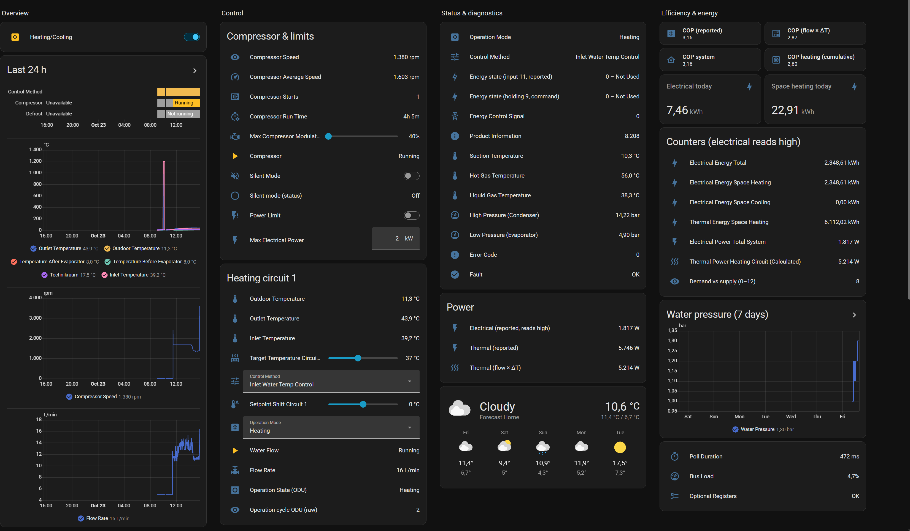

# Example dashboard

Two ready-to-paste dashboards:

- [Compact view](#compact-view): the essentials on one page.
- [Full view](#full-view): a sections view with every entity of the integration, grouped by topic.

## Compact view

A ready-to-paste dashboard view for the heat pump, built from Home Assistant's own cards only; nothing to install. Entity ids are the defaults (`…lg_therma_v_r290_…`); if you renamed yours, adjust them.

**To use it:** *Settings → Dashboards → Add dashboard → New dashboard from scratch*, open it, *⋮ → Edit dashboard → ⋮ → Raw configuration editor*, and paste the YAML below (it replaces the empty `views:`). Or paste only the cards you want into an existing view.

Cards marked *(option)* need that option switched on in *Configure → Options*; remove them otherwise, or Home Assistant shows them as unavailable.

```yaml
views:
  - title: Heat pump
    path: heat-pump
    icon: mdi:heat-pump
    cards:
      # --- Now --------------------------------------------------------------
      - type: tile
        entity: sensor.lg_therma_v_r290_operation_state_odu
        name: Outdoor unit
      - type: glance
        title: Temperatures
        columns: 4
        entities:
          - entity: sensor.lg_therma_v_r290_outdoor_temperature
            name: Outdoor
          - entity: sensor.lg_therma_v_r290_outlet_temperature
            name: Flow
          - entity: sensor.lg_therma_v_r290_inlet_temperature
            name: Return
          - entity: sensor.lg_therma_v_r290_dhw_temperature
            name: DHW
      - type: glance
        title: Running
        columns: 4
        entities:
          - entity: binary_sensor.lg_therma_v_r290_compressor
            name: Compressor
          - entity: sensor.lg_therma_v_r290_compressor_speed
            name: Speed
          - entity: sensor.lg_therma_v_r290_flow_rate
            name: Flow rate
          - entity: binary_sensor.lg_therma_v_r290_defrost
            name: Defrost
          - entity: binary_sensor.lg_therma_v_r290_dhw_heating
            name: DHW heating
          - entity: binary_sensor.lg_therma_v_r290_backup_heater_step_1
            name: Heater 1
          - entity: binary_sensor.lg_therma_v_r290_backup_heater_step_2
            name: Heater 2
          - entity: binary_sensor.lg_therma_v_r290_fault
            name: Fault

      # --- Efficiency ---------------------------------------------------------
      # COP against your own meter (option: External electricity meter,
      # power sensor). Without it, use sensor.lg_therma_v_r290_cop_reported
      # (option: Energy registers), which tends to read low.
      - type: gauge
        entity: sensor.lg_therma_v_r290_cop_external_meter
        name: COP now
        min: 0
        max: 7
        needle: true
        severity:
          red: 0
          yellow: 2.5
          green: 3.5
      - type: entities
        title: Efficiency
        entities:
          - entity: sensor.lg_therma_v_r290_thermal_power_calculated
            name: Thermal power (flow × ΔT)
          - entity: sensor.lg_therma_v_r290_electrical_power_heat_pump
            name: Electrical power (unit, reads high)  # option: Energy registers
          - entity: sensor.lg_therma_v_r290_cop_cumulative_external_meter
            name: JAZ since start  # option: External electricity meter, energy sensor
          - entity: sensor.lg_therma_v_r290_thermal_energy_calculated
            name: Heat delivered  # option: External electricity meter, energy sensor

      # --- Controls -----------------------------------------------------------
      - type: entities
        title: Controls
        entities:
          - entity: switch.lg_therma_v_r290_heating_cooling
            name: Heating/Cooling
          - entity: switch.lg_therma_v_r290_dhw
            name: DHW
          - entity: switch.lg_therma_v_r290_silent_mode
            name: Silent mode
          - entity: select.lg_therma_v_r290_operation_mode
          - entity: select.lg_therma_v_r290_control_method
          - entity: number.lg_therma_v_r290_target_temperature_circuit_1_radiators
            name: Flow target circuit 1
          - entity: number.lg_therma_v_r290_setpoint_shift_circuit_1
            name: Shift circuit 1
          - entity: number.lg_therma_v_r290_dhw_target_temperature
            name: DHW target
          - entity: sensor.lg_therma_v_r290_energy_state_reported
            name: Energy state (SG Ready)

      # --- History ------------------------------------------------------------
      - type: history-graph
        title: Temperatures, 24 h
        hours_to_show: 24
        entities:
          - entity: sensor.lg_therma_v_r290_outlet_temperature
            name: Flow
          - entity: sensor.lg_therma_v_r290_inlet_temperature
            name: Return
          - entity: sensor.lg_therma_v_r290_outdoor_temperature
            name: Outdoor
          - entity: sensor.lg_therma_v_r290_dhw_temperature
            name: DHW
      - type: history-graph
        title: Compressor, 24 h
        hours_to_show: 24
        entities:
          - entity: sensor.lg_therma_v_r290_compressor_speed
            name: Speed
          - entity: binary_sensor.lg_therma_v_r290_compressor
            name: Running
          - entity: binary_sensor.lg_therma_v_r290_defrost
            name: Defrost

      # --- Per day (option: Compressor statistics) ----------------------------
      # Starts and run time are counters; "change" per day turns them into
      # starts per day and hours per day. Many starts for few hours = cycling.
      - type: statistics-graph
        title: Compressor starts per day
        chart_type: bar
        period: day
        days_to_show: 30
        stat_types:
          - change
        entities:
          - entity: sensor.lg_therma_v_r290_compressor_starts
            name: Starts
      - type: statistics-graph
        title: Compressor hours per day
        chart_type: bar
        period: day
        days_to_show: 30
        stat_types:
          - change
        entities:
          - entity: sensor.lg_therma_v_r290_compressor_run_time
            name: Hours
      - type: history-graph
        title: Average compressor speed while running, per day
        hours_to_show: 720
        entities:
          - entity: sensor.lg_therma_v_r290_compressor_average_speed
            name: Average rpm

      # --- Energy per day (option: External electricity meter / Energy registers)
      - type: statistics-graph
        title: Heat delivered per day
        chart_type: bar
        period: day
        days_to_show: 30
        stat_types:
          - change
        entities:
          - entity: sensor.lg_therma_v_r290_thermal_energy_calculated
            name: Heat (flow × ΔT)
          - entity: sensor.lg_therma_v_r290_thermal_energy_space_heating
            name: Heat (unit's counter)
```

### Notes

- **Statistics cards** need a day or two of data before they show bars; they read Home Assistant's long-term statistics, not the history.
- **Your own meter:** to compare electrical energy per day, add your meter's energy sensor to the *Heat delivered per day* card (or the Energy dashboard, *Individual devices*).
- **Names** on the cards are short labels set in the YAML; the entities keep their own names elsewhere.

## Full view

A sections view (Home Assistant 2024.3+) with every entity the integration creates: overview with a 24 h history, controls, status and diagnostics, efficiency and energy, the rarely used inputs, the energy states of holding 9, DHW and the experimental registers. It is a separate dashboard; do not paste it into the compact one.



Most of it needs options switched on in *Configure → Options*; without them those rows show *Entity not found*. Remove them, or switch the option on:

| Option | Cards |
|---|---|
| Energy registers | *Power* (electrical, thermal reported), the COP tiles, *Electrical today*, *Space heating today*, *Counters*, *Demand vs supply* |
| Compressor statistics | *Compressor Average Speed*, *Compressor Starts*, *Compressor Run Time*, *Starts today*, *Run time today* |
| Compressor modulation limit | *Max Compressor Modulation* |
| Power limit | *Power Limit*, *Max Electrical Power* |
| Poll statistics | *Poll Duration*, *Bus Load* |
| Experimental registers | the *Experimental registers* section |

The *Target Room Air Temperature Circuit 1/2* sensors are disabled by default; enable them in the entity settings or remove the tiles. The weather card uses `weather.forecast_home`, the default of the Met.no integration; replace it with your own weather entity.

*Starts today*, *Run time today*, *Electrical today* and *Space heating today* read the long-term statistics, so they count from the time the integration was set up: the first day is incomplete.

The YAML is in its own file: **[dashboard-full.yaml](dashboard-full.yaml)**. Open it, use *Raw* (or the copy button) on GitHub, and paste all of it into the raw configuration editor of a new, empty dashboard.
